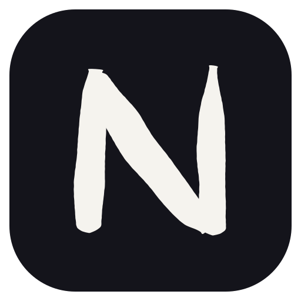

<p align="center">
  
</p>

<h1 align="center">Nary</h1>

<p align="center">
  A lightweight, framework-agnostic canvas engine for building infinite whiteboard applications — written in Rust, distributed to npm (WASM) and PyPI (Python).
</p>

<p align="center">
  <a href="https://github.com/fazelstudio/opennary/actions/workflows/ci.yml"></a>
  <a href="https://www.npmjs.com/package/@fazelstudio/nary"></a>
  <a href="https://pypi.org/project/nary/"></a>
  <a href="https://github.com/fazelstudio/opennary/blob/main/LICENSE"></a>
</p>

## Features

- **Shape primitives** — Rectangle (with roundness), ellipse, line, arrow (arrow/bar/dot heads), freedraw, text, frame, image (with crop), vector path, component instance
- **Selection** — Click, multi-select (Shift+click), rubber-band selection, group-aware drill-in
- **Transform** — Move, resize (8 handles, rotation-aware), rotate (15° snap), multi-select proportional resize
- **Style** — Solid colors, linear/radial gradients, hachure/cross-hatch fills, stroke styles (solid/dashed/dotted), opacity
- **Text** — In-place editing, auto-resize, alignment, IME composition support
- **Arrows** — Free arrows or bound to elements (auto-follow on move/resize/rotate)
- **History** — Undo/redo via command pattern with exact snapshot inversion
- **Clipboard** — Copy, paste (cascade offset), cut, duplicate — with id/group/binding remap
- **Organization** — Groups, layers (z-order), lock, frames with constraints and flex-like auto-layout
- **Precision tools** — Align (6 ops), distribute (2 ops), snap to grid and object edges
- **Vector editing** — Multi-click pen with symmetric Bezier handles, path anchor/handle editing, image cropping
- **Spatial index** — Grid-based spatial hash for fast hit-testing and viewport culling
- **Export/Import** — Versioned JSON scene serialization and PNG export planning
- **Headless engine API** — 100% usable without any UI framework; hosts render from a deterministic `RenderModel`
- **Plugin system** — Custom shapes, tools, commands, and serializers via extension traits

## Install

```bash
npm install @fazelstudio/nary
# or
bun add @fazelstudio/nary
```

```bash
pip install nary
```

Usage: [`docs/guides/javascript.md`](./docs/guides/javascript.md) for
JavaScript/TypeScript, [`docs/guides/python.md`](./docs/guides/python.md)
for Python.

## Crates

| Crate | Description |
|----|-------------|
| [`nary-geometry`](./crates/nary-geometry) | Pure 2D math — points, bounds, transforms, hit-testing, spatial grid, snapping, viewport |
| [`nary-core`](./crates/nary-core) | Document domain — elements, document store, history/commands, editor session, clipboard, components, plugins |
| [`nary-io`](./crates/nary-io) | Interchange — versioned JSON schema, staged import pipeline, clipboard codec, PNG export descriptors |
| [`nary-bindings`](./crates/nary-bindings) | Host boundary — JSON-string batch protocol, `Engine` facade, render/session DTOs |
| [`nary`](./crates/nary) | npm distribution — `wasm-pack` target, published as `@fazelstudio/nary` |
| [`nary-python`](./crates/nary-python) | PyPI distribution — `maturin`/PyO3 bindings, published as `nary` |

Dependency direction: `nary`/`nary-python` → `nary-bindings` → `nary-io` → `nary-core` → `nary-geometry`.

## Docs

- [`docs/`](./docs/) — product scope, technical contract, and guides.
- [`docs/guides/javascript.md`](./docs/guides/javascript.md) — JavaScript/TypeScript usage.
- [`docs/guides/python.md`](./docs/guides/python.md) — Python usage.
- [`docs/guides/commands.md`](./docs/guides/commands.md) — command and protocol reference.
- [`docs/guides/extensions.md`](./docs/guides/extensions.md) — extensions without forking.
- [`docs/guides/desktop.md`](./docs/guides/desktop.md) — desktop demo (reference host).
- [`docs/ARCHITECTURE.md`](./docs/ARCHITECTURE.md) — technical contract.
- [`docs/PRD.md`](./docs/PRD.md) — scope and out-of-scope boundaries.
- [`crates/README.md`](./crates/README.md) — Rust workspace map and design rules.

## Development

See [`DEVELOPMENT.md`](./DEVELOPMENT.md). Contributing: see [`CONTRIBUTING.md`](./CONTRIBUTING.md).

## License

[MIT](./LICENSE) © [fazelstudio](https://github.com/fazelstudio)
