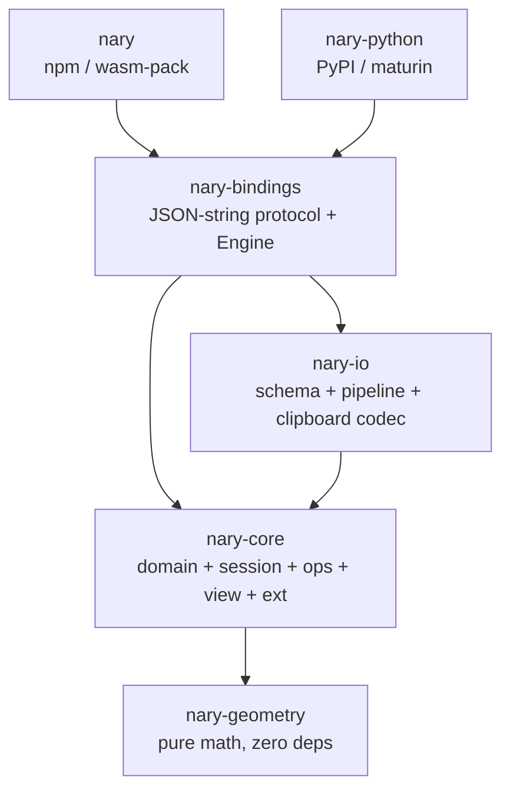

# 00 — Engine Audit (Phase 1, read-only)

Date: 2026-10-04. Method: 4 parallel read-only sub-agents (workspace+datamodel,
rendering+geometry, interaction+text, bindings+tests) plus direct verification by
the lead agent. No code was changed in this phase.

Verification actually run (not assumed):

- `cargo test --workspace` → all suites pass (nary 4, bindings 9, bindings_model 28,
  bindings_react 37, layout_binding_ops 9, nary-core unit 204, benchmark_model 11,
  clipboard 19, document 19, geometry 17, history 18, interaction 46, parity 57,
  plugin_example 4, workspace_wiring 2, desktop lib 14, nary-python 2, plus geometry/io
  units). Exit 0.
- `cargo clippy --workspace --all-targets` → finished with no warnings.
- `cargo tree --workspace --depth 2` → one-way DAG confirmed (see §2).
- Grep over `crates/*/src/*.rs`: zero `todo!`/`unimplemented!`, zero `unsafe`,
  zero GPU/graphics crate references (`wgpu|vello|tiny-skia|lyon|kurbo|parry|clipper`
  only appear in `ENGINE_MASTER_INSTRUCTIONS.md` as advisory text).
- `unwrap()`/`expect()` hits (~400) are inside `#[cfg(test)]` modules and doctests;
  no occurrences found in non-test library paths sampled
  (`document.rs`, `element.rs`, `engine.rs`, `protocol.rs`, `nary-io` sources).

## 1. Crate map

| Crate | Responsibility | Direct deps | Size (approx) | Health |
|---|---|---|---|---|
| `nary-geometry` 0.1.0 | Pure 2D math: `point`, `rect`/`Bounds`, `segment`, `rotation`, `hit`, `path`, `transform`, `spatial` (`SpatialGrid`), `snap`, `viewport`. Zero deps. | none | 11 files, ~2.4k lines | Clean leaf, well-scoped |
| `nary-core` 0.1.0 | Persistent domain + editor session: `domain` (`element`, `document`), `history` (`command`, `history`), `session` (`editor`, `editor_state`, `selection`, `gesture`, `text_session`, `interaction`), `ops` (group, lock, zorder, style, frame, alignment, arrow_binding, constraints, auto_layout, clipboard, components, assets, path_edit), `view` (hit_test, render_model, canvas_mode, theme), `ext` (shape_registry, shape_extension, plugin, command_extension, serializer). `Document` is the sole version/nonce authority; mutation via `Command`. | `nary-geometry` (path) only | 43 files, ~23k lines (~85% of engine Rust) | God-crate risk: 33 `pub mod`, `components.rs` alone ~1.5k lines |
| `nary-io` 0.1.0 | Interchange: versioned JSON schema, staged import pipeline, clipboard codec, PNG export descriptors. No files/OS-clipboard/canvas inside. | `nary-core`, `serde`, `serde_json` | 5 files, ~2.1k lines | Focused |
| `nary-bindings` 0.1.0 | Only stateful host boundary: JSON-string `BatchOp` protocol (71 ops), instance-scoped `Engine`, `render_dto`/`session` shapes, `wasm::JsEngine` (test-gated), `tauri` thin wrapper (no tauri dep). | `nary-core`, `nary-io`, `serde`, `serde_json`, `wasm-bindgen` | 6 files, ~5.4k lines | Large but disciplined DTO surface |
| `nary` 0.1.0 (npm `@fazelstudio/nary`) | `wasm-pack` entry, string-only `JsEngine` facade over `nary-bindings::Engine`. `wasm-opt=false` (documented Windows tradeoff). | `nary-bindings`, `wasm-bindgen`, `serde_json` | 2 files, ~290 lines | Thin, correct |
| `nary-python` (`nary-py` 0.1.0, PyPI `nary`) | `maturin`/PyO3 distribution, instance-scoped `PyEngine`, manual `PyDict`/`PyList` ↔ JSON (no `pythonize`). | `nary-bindings`, `nary-core` (unused — see §4.2), `pyo3` 0.22, `serde_json` | 1 Rust file, 549 lines + `python/nary/__init__.py` | Thin, one dead dep |
| `nary-desktop` (Tauri host) | Reference host, outside engine crates. `AppState{engine: Mutex<Engine>}`. | `tauri` 2 + `nary-bindings` + `nary-core` | host | Correctly outside wiring |

Dependency graph (`cargo tree` verified, `Cargo.toml` cross-checked):

Direction is acyclic and matches `crates/README.md`. `workspace_wiring` test only
asserts crate-name identities plus `EngineError` usability — it does **not**
mechanically enforce the full DAG (overclaim in `crates/README.md:42-43`).

Toolchain notes: `resolver="2"`, `edition 2021` everywhere, workspace lints
(`missing_docs`, `clippy::all` as warn, opted-in per crate). No `[features]`
anywhere (CI `--all-features` is vacuous). No `rust-toolchain*`, no
`rust-version`/MSRV (CI floats on `stable`, local `rustc 1.95.0`). Release profile
sets `codegen-units=1, lto, opt-level=3, panic="abort", strip`. CI has two jobs
only (rust fmt/check/clippy/test on ubuntu, desktop typecheck on windows) — no
WASM, Python, or publish jobs. `pkg/` is empty (build-on-release).

## 2. Data model

- 11 element variants (`element.rs:803-826`): `Rectangle, Ellipse, Line, Arrow,
  Text, Freedraw, Frame, Image, Path, Instance, Custom`. No built-in
  `Polygon`/`Star`/`Video`/SVG-nested — custom types go through `Custom` +
  `ShapeExtension` (star example exists as a test).
- `BaseElement` (`element.rs:553-600`): scene-space `x/y/w/h`, radians `rotation`,
  `stroke_color`, `background_color: FillStyle` (solid/gradient) **plus**
  `fill_style: ElementFillStyle` (solid/hachure/cross-hatch) — dual fill
  representation, both must be consulted. `opacity 0-100`, `seed`, `version` +
  `versionNonce`, `isDeleted` (soft delete), innermost-first `groupIds`, `locked`,
  `hidden`, `frameId?`, `constraints?`, `childLayoutSizing?`.
- Validation is two-phase (validate-then-store): per-element finiteness checks in
  `element.rs:894-978`, cross-refs (`frame_id`, bindings, `container_id`) deferred
  to `Document::validate`. Non-finite JSON fails loudly on export (JSON has no
  NaN/Inf) instead of emitting `null`.
- IDs: `ElementId(String)` newtype; `IdGenerator: Send+Sync` trait with
  `CounterIdGenerator` for determinism; authority in `Document::fresh_*`;
  paste remaps ids, one fresh group id per source group, cascade offset 10.0.
- Storage is `HashMap<ElementId, Element>` (incl. tombstones) + explicit
  `order: Vec<ElementId>` (back-to-front z-order) + `scene_nonce: u64`
  (saturating) + owned `SpatialGrid` (cell 200) synced on every mutation.
  Not arena/slotmap/ECS. `upsert` is the sole mutation path; `soft_delete` is
  silent no-op on ghosts (no nonce bump); `hard_delete` exists as a history
  primitive; `restore_exact` (crate-internal) writes snapshots verbatim for
  undo without version bump.
- Serialization lives in `nary-io` (never derived on domain): versioned envelope
  `{schemaVersion, elements, elementOrder}`, `SCHEMA_VERSION=1`,
  `PROTOCOL_VERSION=1`, `PLUGIN_PROTOCOL_VERSION=1`, all crates `0.1.0`.
  Unknown element types on import are skipped + counted. `Custom` exports but
  never imports (asymmetry, undocumented — see §4.3). Clipboard codec reads
  versioned **or** bare-array (TS-authored compat). PNG export is pure math
  (`PngExportPlan`, max 4096px); rasterization stays host-side.

## 3. Rendering, geometry, interaction (summary)

- **No GPU/raster backend in-engine.** Output is a deterministic `RenderModel`
  (cull → frame-clip partition → per-entry `DrawEntry` with rotation-aware AABB,
  `PaintDesc`, absolute points/segments) plus selection overlay, snap guides,
  text-edit state. Hosts draw it (desktop: single Canvas2D canvas + rAF loop,
  DPR-aware; `drawImage` is a placeholder — real image pixels never drawn there;
  `fillHatch` and grid passes are carried but not painted by the desktop host).
  No tessellation (curves ship as polylines/bezier segments; `path.rs` flattening
  with `FLATTEN_SAMPLES=10` is hit-test-only). Text is `DrawDetail::Text` +
  `TextMeasurer` trait with `1.25` line-height and `0.6` fallback factor —
  shaping/layout/font loading stay host-side. No shadow/blur/mask/layer effects
  beyond `globalAlpha = opacity/100`.
- Geometry (`nary-geometry`, zero deps) covers points, AABB incl. rotated bounds,
  resize/rotate/handle math (8 handles + rotate handle, `MIN_SIZE=1`,
  Shift aspect-lock / 15° snap), viewport math (zoom clamp 0.1–10),
  segment/polyline/point-in-polygon/ellipse/triangle primitives, bezier flatten,
  uniform grid-hash spatial index (correctness-first: dedup, false-positive ok,
  never false-negative), zoom-normalized snap (grid + object edges, object wins,
  guides ±20). Missing: boolean ops (only AABB `union`/`intersects` exist),
  curve-curve intersection, offsetting, triangulation, arc-length, color math.
- Hit-testing is staged (AABB → exact → geometry) but `hit_test_top/all` and
  `query_in_bounds` are **linear scans**; the grid backs `RenderModel` culling
  only (explicit deferral comment `hit_test.rs:271-273`). Benchmark on record
  (5k random, 2026-08-29): grid 6.32× faster for hit-test, 0.89× for viewport
  culling — retained for interaction latency.
- Tools: `ToolId{Select, Text, Draw(String), Custom(String)}` + instance-scoped
  `ToolRegistry` (names only — no per-tool behavior hooks; custom tools capture
  inertly, host-owned). Pointer-phase machine
  (`Idle/Pressed/DraggingMove/DraggingResize/DraggingRotate/RubberBand/Drawing/Panning`)
  with 4px drag threshold, one history entry per gesture, read-only
  `preview_*` sharing commit math. Keyboard intents include Delete/nudge/undo/redo/
  Escape-chain; clipboard intents surface as `UnhandledIntent` for the host.
  Selection is ordered-deduped transient state with group-aware resolve
  (single-level drill, box-rubber only, no lasso/hover, single-select rotate).
- Undo/redo is command-pattern with exact-snapshot inversion
  (`SlotDelta{before,after}`, `HistoryEntry`, `max=100`, empty-commit preserves
  redo, `transaction` atomic, nesting rejected). Every intent in `command.rs`,
  `alignment.rs`, `auto_layout.rs`, `path_edit.rs`, `arrow_binding.rs` is
  one-entry. Gaps: direct `doc.upsert` calls in `frame.rs`/`style.rs` rely on
  callers to wrap in a transaction; `Editor::undo` refuses mid-gesture/text
  instead of auto-committing (hosts must disable UI accordingly).
- Sessions present: pen (multi-click path, Alt-break handles, close radius),
  path-edit (anchor/handle/add/delete press kinds, renormalize, one-entry
  commit), crop (natural-px, 8 handles, 10px min), text (draft/caret char-index,
  composition buffering, grow-only autosize, trim + delete-when-empty, outside-
  click/tool-switch/Escape commit, `SetText` one entry). Constraints
  (Min/Max/Center/Stretch/Scale) and auto-layout (H/V, gap/padding,
  Start/Center/End/SpaceBetween, Fill split, Fixed/Hug) are pure math + one-entry
  commands, manual trigger only (no live re-layout). Arrow binding
  (threshold 20, focus/gap, follow on move/resize/nudge/paste, detach on delete).
  Align (6-mode) + distribute (outer-fixed, <3 no-op). Group/lock/z-order
  (block moves, unknown-ignored) all one-entry.
- Text/font: plain single-style text only. No shaping/layout/font-loading/
  rich-spans/bidi/ligature anywhere in core (grep-verified zero hits for
  `bidi|ligature|shaping|harfbuzz|parley|cosmic|fontdb|opentype|rich`). IME state
  machine exists; candidate window/focus stays host-side. Container-bound text
  (`container_id`) has storage + clipboard remap but no creation/edit flow.

## 4. Findings

### 4.1 Coupling, overlap, god-crate, dead code, leaks

1. **God-crate**: `nary-core` holds ~85% of engine Rust (33 modules, `components.rs`
   ~1.5k lines). A future `session`-vs-`domain` split will be painful; gate it
   behind an ADR, do not freestyle.
2. **Dead dep**: `nary-python/Cargo.toml:14` declares `nary-core` but
   `src/lib.rs` only uses `nary_bindings` (grep-verified). Widen build graph
   against the thin-wrapper rule — remove it (planned Phase 5 hygiene fix).
3. **Custom import asymmetry**: `schema.rs:890-903` exports `Custom`, but
   `element_from_value:604-744` matches only the 10 built-in `TYPE_*` tags and
   drops anything else. Round-trip out works, back in silently skips. Either
   document as intentional (opaque host-owned types re-register at runtime) or
   wire `SerializerExtension` into import.
4. **`Editor` owns `ToolRegistry` but not `ShapeRegistry`/`PluginRegistry`** —
   plugin-declared tools/shapes need manual host glue (`register_custom` +
   allow-list). `PluginRegistry::command_by_id` is documented as the future
   `executeCommand` seam; no such op exists yet on `Engine`.
5. **Doc drift**: ADR-0010 still names removed TS paths and `cargo+wasm-bindgen`
   vs current `wasm-pack`; `crates/README.md` overclaims `workspace_wiring`
   enforcement. Fix docs, not code.

### 4.2 API surface notes

- 71 `BatchOp`s cover CRUD, history, normalized input, text/IME, layering/layout,
  pen/crop/path-edit sessions, viewport/configure, and read-only queries
  (`renderModel`, `preview*`, `contextMenu`, `drainEvents`, `sessionState`).
  Batch is per-op atomic, **not** a transaction; queries observe prior ops in the
  same batch (one frame = one crossing). Whole-batch parse failures use
  `ErrorEnvelope`; per-op failures use `OpResult{code,message}` with stable codes
  (`invalidInput/notFound/invariantViolation/unsupported/parseError`).
- `setStyle` is scalar-only; gradient backgrounds are an explicit per-op
  `unsupported` error (fill DTO stays owned by `nary-io` schema per ADR-0010).
- Bindings are thin (verified: `nary`, `nary-python`, `tauri.rs`, desktop `lib.rs`
  all delegate to `Engine`; even Python convenience helpers just format
  `[{"op":…}]` then `apply_batch`). Minor intentional asymmetry: Python offers
  layout/pen/crop/path helpers while WASM requires raw `apply_batch`.

### 4.3 Test/benchmark inventory

- ~500 `#[test]` total, all passing: parity (57, 12 scenario groups vs TS oracle),
  interaction (46), bindings_react (37), bindings_model (28), io (21, incl. true
  TS-generated golden fixtures), document/clipboard/history/geometry (17–19
  each), layout_binding_ops (9), plugin_example star (4), benchmark smoke (11),
  plus ~200 units in `src/`.
- No `proptest`/`criterion`/`divan`/`insta`/`cargo-fuzz`, no `benches/`, no
  baseline files, no CI perf gate. `benchmark_model.rs` prints `Instant`
  timings (no assertions, always runs under `cargo test`). `BENCHMARK_RESULTS.md`
  is a single 5k data point (no machine/commit info, no 1k/10k/100k/1M series).
  Parsers have NaN/non-finite rejection tests but no fuzz corpus. `RenderModel`
  determinism is self-equality only (no stored golden). Known weak asserts in
  `parity_model` (snap no-ops, loose rotate tolerance) are documented.

## 5. Feature inventory (against §4.2 checklist shorthand)

- ✅ Solid: rectangle/ellipse/line/arrow/text/freedraw/frame/image/path/instance/
  custom storage; select/move/resize/rotate; group/ungroup; lock/hide; z-order;
  align/distribute; snap-to-grid/object + guides; arrow binding; constraints +
  manual auto-layout; pen + path-edit + crop sessions; clipboard (internal, fresh
  ids, cascade); undo/redo (atomic, coalesced per gesture); pan/zoom + viewport
  culling + spatial grid; JSON import/export + versioning; PNG plan; events/
  introspection (`query_spatial`, `raw_bounds`, `status`, `sessionState`).
- 🟡 Partial: gradients (linear/radial stored, angular/diamond absent; host
  rebuilds endpoints; `setStyle` gradient rejected); text (plain only, host
  measures); image (reference + crop rect only, host fetches/decodes/draws);
  components (define/resolve/override-cache/actions present, no nesting beyond
  frame expansion, no variant system); render (DTO only, desktop host drops
  images/hatch/grid/bounded-chrome); plugin/extension (traits + registries +
  star example work, but no `executeCommand` op, no out-of-tree crate example,
  `plugins/README.md` is one line).
- ❌ Absent: polygon/star/video/embedded primitives (via Custom only, no
  first-class import); pages/canvases tree; layers-panel primitive beyond z-order
  vector; boolean ops; outline-stroke/flatten/offset/simplify/convert-to-path;
  skew; lasso/hover/multi-rotate; eraser/eyedropper/rulers; rich text/bidi/
  variable fonts/text-on-path; live auto-layout; history branching; CRDT/
  multiplayer; SVG/PDF import/export; asset GC/dedup/quota + lazy/streaming;
  tracing/profiling hooks; `tracing`/`cargo-deny`/`cargo-audit`/`cargo-udeps`/
  public-API guards in CI.

Desktop impact note (per master §0: ignored, do not touch): all findings above
are engine-internal. The desktop host consumes `Engine` + `render_dto` + protocol
v1 only; no desktop changes are proposed in this phase. Any future protocol
addition must stay additive or bump `PROTOCOL_VERSION` with a TS-mirror note.
