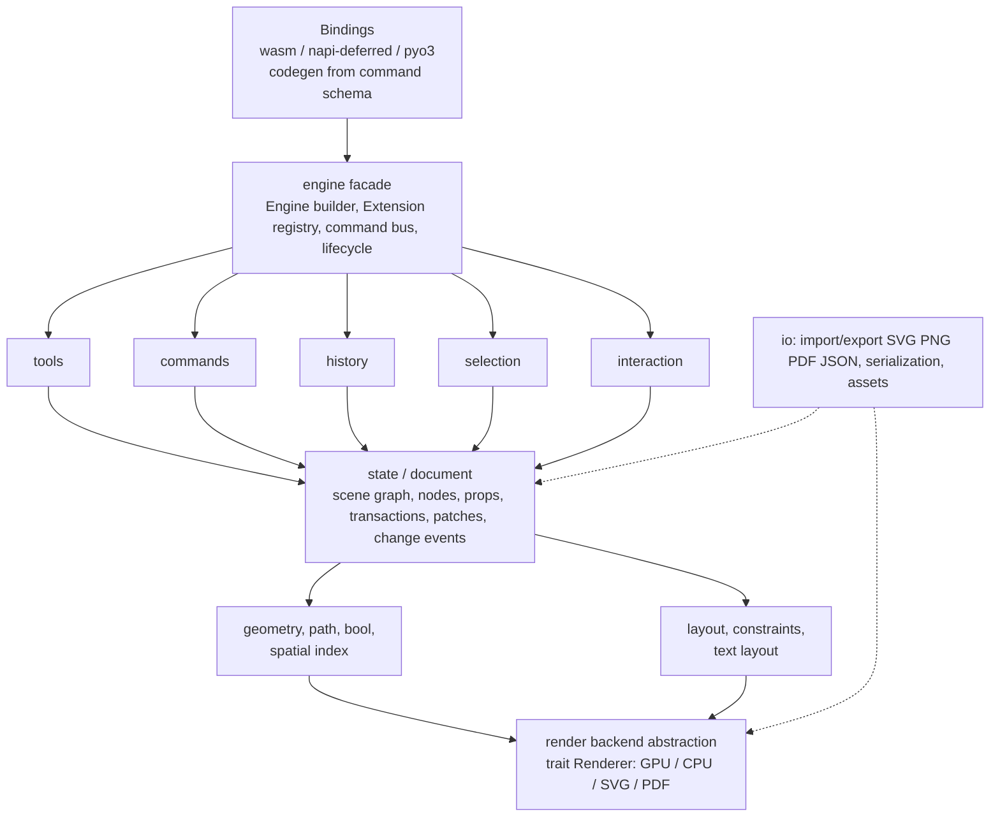

# 03 — Target Architecture (Phase 4)

Status: target design. Everything below is either already true in the repo
(cited) or an additive completion behind an existing seam (marked **NEW**).
Nothing here moves files across crates or breaks protocol v1. Decisions are
recorded in `docs/adr/0015–0017`.

## 1. Layering (reference, adapted from research)

Mapping to the repo (verified in `00-audit.md`):

- Bindings = `nary-bindings` (`Engine`, `BatchOp`, DTOs) + `nary`/`nary-python`
  thin wrappers. **NEW**: generated TS `.d.ts` / Python `.pyi` from the single
  command schema (§3).
- Engine facade = `nary-bindings::Engine` over `nary-core::Editor`
  (`editor.rs`), `HistoryManager`, `Clipboard`, registries.
- Tools/commands/history/selection/interaction = `interaction.rs`
  (phase machine + intents), `command.rs` + `command_extension.rs`,
  `history.rs`, `selection.rs` + `editor_state.rs`, `gesture.rs`.
- State/document = `document.rs` + `element.rs` (sole version/nonce authority,
  validate-then-store, soft-delete, change events).
- Geometry/path/spatial = `nary-geometry` (zero deps); boolean ops land here as
  pure math when scoped (ADR-0017).
- Layout/text = `constraints.rs`, `auto_layout.rs`, `alignment.rs`,
  `text_session.rs` + `TextMeasurer` trait (host-supplied shaping).
- Render abstraction = `RenderModel`/`DrawEntry`/`PaintDesc` DTOs (data, not
  raster) + `render_dto.rs` mapping. Backends (Canvas2D now; Skia/WebGPU later)
  are host crates/extensions behind this seam — never inside `nary-core`.
- IO = `nary-io` (`schema`, `pipeline`, `clipboard_codec`, PNG plan).

Principles (enforced, not aspirational):

- `nary-core` depends only on `nary-geometry`. Never on renderer, binding, UI,
  DOM/Canvas, React, Tauri. (`workspace_wiring` asserts the DAG — **NEW**:
  extend it to the full chain; today it only checks identities.)
- Dependency direction is one-way and acyclic (`cargo tree` verified 2026-10-04).
- Renderer is a data seam; backends are separate crates/extensions.
- Bindings are thin: no business logic (verified: every wrapper delegates to
  `Engine::apply_batch` or shared `nary_core` math).

## 2. CodeMirror-style modularity

Core stays minimal: state/document, transactions, extension system, command bus.
Everything else — each shape, each tool, history, snapping, render mapping —
is an **extension** that composes. Names are adapted to a canvas engine;
CodeMirror originals are in parentheses.

### 2.1 Concepts

- `Extension` (Extension): one unit of capability; nestable; resolved with
  **precedence**. Already embodied by `Plugin` (register → activate → use →
  deactivate → dispose, `plugin.rs`) declaring capabilities through
  `PluginContext{tools, shapes, commands, serializers, importers, exporters}`.
  **NEW**: `Editor` accepts a `PluginRegistry` inlet so declared capabilities
  flow into the live session (today the host must glue `register_custom` +
  allow-list manually).
- `Facet` (Facet): configuration point fed by many extensions with a `combine`
  function. Embodied today by `Theme` deep-merge (`resolve_theme`) and
  `SnapConfig` partial merge. **NEW**: formalize as `Facet<Input, Output>` with
  documented combiners (highest-wins for scalar defaults, concatenation for
  provider lists such as snap sources, OR for flags) instead of ad-hoc merges.
- `StateField` (StateField): extension-owned state inside the transaction
  lifecycle. Embodied today by `SelectionState`, `TextSession`, `PenSession`,
  `CropSession`, `PathEditor`, snap-config, allow-list. Rule: fields update
  through transactions; hosts never mutate them directly.
- `Transaction` + `Effect` (Transaction + StateEffect): every state change is
  an atomic transaction producing patches for undo/redo, sync, and events.
  Embodied by `Command` + `CommandContext` accumulating `SlotDelta{before,
  after}` into one `HistoryEntry`, plus `EditorEvent`s. **NEW**: separate
  `docChanged` from `selectionOnly`/`viewportOnly` effects so subscribers get
  fine granularity (avoid "everything changed"); carry `userEvent` annotations
  (e.g. `drag` vs `key`) for coalescing and future sync.
- `Compartment` (Compartment): runtime reconfiguration without rebuilding the
  engine. Embodied by `Configure{enabledTools, theme, snap}` (three-state
  `enabledTools`: absent = unchanged, `null` = clear, array = set) and
  `set_active_tool`. **NEW**: document these as the compartment mechanism and
  keep them atomic (validate-before-write, already true in `engine.rs:935-973`).
- `Plugin` / `ViewPlugin` (ViewPlugin): lifecycle side-effects and resources
  (`init/update/destroy`). Rule: view plugins derive from `RenderModel` and
  never store canonical geometry. Host canvases, grid painters, minimaps, and
  collaborator cursors are view plugins.
- Registries (open): node types, tools, renderers/backends, importers/exporters,
  commands. Present: `ShapeRegistry` + `ShapeExtension` (object-safe,
  `render_desc/hit_test/bounds` fallible with raw-box fallback),
  `ToolRegistry`, `CommandExtension`, `SerializerExtension` (+ importer/
  exporter), `ComponentRegistry`. **NEW**: `executeCommand(id, payload)`
  protocol op dispatching through `PluginRegistry::command_by_id` (the seam
  already documented in `plugin.rs:293-303`); renderer/importer/exporter lookup
  points mirroring it.

### 2.2 Node-type contract (open registry)

A third party registers a type with, at minimum: property schema + validation,
default props, bounds, hit-test, render description, serialization, and
transform handles. `ShapeExtension` already defines this surface
(`shape_extension.rs:36-118`); `Custom{type_name, data}` carries the data
opaquely. **NEW**: wire `SerializerExtension` into import so `Custom` round-
trips (today export-only — `02-gap-analysis.md` E1), and publish the contract
with stability markers (§2.5).

### 2.3 Tool contract (open registry)

A tool is a state-machine fragment (`press → drag-threshold → commit/cancel`)
participating in the pointer-phase machine, not a string switch. `ToolId`
parsing plus the `PressedCapture` machine already define the skeleton;
**NEW**: tool behavior hooks so custom tools are not inert captures
(`editor.rs:1169-1187` documents today's intentional inertness).

### 2.4 External extensions

Three paths, decided in ADR-0017:

1. **Rust crate (compile-time)** — fully supported today (`plugin_example.rs`
   star proves it). The primary path for node types, tools, commands,
   importers/exporters needing core math.
2. **Host callback (JS/Python via protocol)** — supported for UI binding and
   configuration: custom tools captured core-side and driven host-side,
   `preview_*` queries for live drag rendering, `Configure` compartments.
   Behavior stays host-owned; core never calls out.
3. **Runtime WASM plugin (sandbox)** — evaluated and **deferred**: security,
   versioning, and DX costs outweigh benefits while the compile-time + callback
   paths cover all scoped capabilities. Revisit only with a concrete sandbox
   requirement and a dedicated ADR.

### 2.5 Presets and stability

- **NEW** (additive, feature-less today so zero-cost): `engine-preset-standard`
  (all built-ins) and `engine-preset-minimal` (document + selection + history
  only) as constructor presets over the same registries; Cargo features gate
  future heavy codecs (`usvg`, `parley`) so non-users pay nothing.
- Every extension-API item carries a marker: `stable` (frozen: `BaseElement`,
  protocol envelope, `RenderModel` field semantics), `unstable` (may change:
  new ops, new DTO fields — always additive), `internal` (no cross-crate use).
  The marker lives in rustdoc + the command schema, enforced by review, not by
  a new macro.

## 3. Command system (the owner's core request)

### 3.1 Naming and identity

- Format `namespace.action`, lowerCamel after the dot, stable forever. Namespaces:
  `tool`, `shape`, `node`, `selection`, `style`, `edit`, `view`, `align`,
  `boolean`, `layout`, `text`, `pen`, `crop`, `path`, `frame`, `component`,
  `asset`, `io`, `clipboard`, `history` (alias `edit` for undo/redo per table
  below), `session`, `debug`.
- The 71 wire ops map 1:1 onto command IDs (e.g. `pointerDown` →
  `tool.pointer`, `setBounds` → `node.setBounds`, `bringToFront` →
  `node.bringToFront`, `applyAutoLayout` → `layout.applyAutoLayout`).
  Full table: `05-command-reference.md`. A naming linter test rejects
  non-conforming IDs (**NEW**, mirrors the existing wire-string pin tests in
  `render_dto.rs:1079-1231`).
- Global uniqueness enforced by the central registry; collisions are a clear
  error. External extensions **must** use their own namespace
  (e.g. `acme.sticker.create`).

### 3.2 Schema as single source of truth

Each command declares typed input/output (`serde`), published as JSON Schema
(`schemars`, bindings-side — never in core geometry). From that schema we
generate: Rust types (hand-written today, generated when the registry lands),
TypeScript `.d.ts`, Python `.pyi`, and `05-command-reference.md`. Parity is
mechanical: if a command exists in Rust, it exists in JS and Python.

### 3.3 Two calling conventions

- Typed API per language (ergonomic: `PyEngine.align(...)`, `JsEngine.*`).
- Dynamic dispatch `engine.execute(commandId, payload)` for UI/scripts/automation/
  AI. **NEW** as a protocol op; today `apply_batch` already dispatches 71 ops
  dynamically, so this formalizes the existing mechanism under command IDs.

### 3.4 Introspection, results, undo, keybindings, events

- `commands.list()`, `describe(id)`, `can(id, payload)` (enable/disable UI
  buttons), `dryRun` — the latter two via the existing read-only
  `preview_*`/`contextMenu`/`sessionState` machinery generalized per command.
- Structured results only: `ok/data` or stable `code` (`invalidInput`,
  `notFound`, `invariantViolation`, `unsupported`, `parseError`) + message.
  Never free-form strings (already true: `protocol.rs:828-883`).
- Undoable by default when the document changes; the command declares history
  membership + coalescing (drag = one entry — already true everywhere).
- Keybindings are **not** part of commands: keymap is a separate extension
  mapping input → command (`key_to_intent` + host key routing already embody
  this; no built-in keymap is forced on hosts).
- Subscriptions with fine granularity (§2.1 `docChanged` vs `selectionOnly`):
  selection, active tool, document, viewport, history depth, text-edit state.
- Coverage rule: **no capability without a command**. Matrix
  feature ↔ command ↔ test lives in `08-capability-matrix.md`; CI fails on
  unmapped capabilities (**NEW** check, same spirit as the wire-string pins).

## 4. Performance (constraints, not afterthoughts)

Kept from the master brief §5.3 because the audit shows each already has a
foothold; each bullet names the current mechanism and the next measurement:

- **Data**: Map + explicit order today; `slotmap`/SoA only on benchmark evidence
  (ADR-gated). `SmallVec`/interning/dedup only where profiling shows spill.
  Changes are small patches (`SlotDelta`), never document copies.
- **Reactivity**: granular dirty tracking (`scene_nonce` + `asset_generation`);
  lazy cached layout/bounds (rotation-aware `bounds()` vs layout `raw_bounds()`
  split); batched per-transaction notifications (§2.1 effects).
- **Spatial**: owned grid-hash, incremental sync, tombstone eviction; staged
  hit-test (AABB → exact → geometry); indexed snapping. Next: route hit-test
  and rubber-band through the index (explicitly deferred at
  `hit_test.rs:271-273`) behind benches.
- **Render**: viewport culling + frame-clip partition today; next: tile/scene
  caching with precise invalidation, draw batching/instancing, tessellation +
  glyph-atlas caches, dirty-rect/incremental + async pipeline, 16ms frame
  budget with time-slicing for heavy ops (import, boolean, export).
- **Concurrency**: engine stays single-threaded/deterministic; heavy work moves
  to workers (`rayon` native, Web Worker/wasm-threads in web — host-side,
  `01-research.md §2`).
- **FFI**: batch commands per crossing, patches/deltas (never whole documents),
  typed arrays/shared memory where measured, no JSON on hot paths (binary
  `postcard` only if JSON proves slow), bulk APIs (no per-node call loops —
  already embodied by `EngineStatus` + batched `apply_batch`).
- **Size/startup**: Cargo features for heavy codecs, release `lto`/`opt-level=3`/
  single codegen unit, `wasm-opt` at publish, lazy fonts/assets, streaming
  parse for large documents.

Targets (PRD §5, unchanged): ≥5,000 elements at 60fps pan/zoom; culled frame
<16ms; click hit-test <5ms at 5k; core bundle <150KB gzipped; cold start to
interactive <500ms. Current evidence: culling medians ~0.3ms, hit-test ~10µs
(grid) at 5k (`docs/modules/phases/BENCHMARK_RESULTS.md`); full `07-
performance.md` series (1k/10k/100k/1M) is roadmap M5.

## 5. Bindings and distribution

- One facade crate owns the public API (`nary-bindings`); npm/PyPI wrap it
  thinly (verified). npm = **WASM** (`wasm-pack`, ESM+CJS dual, `.d.ts`,
  `sideEffects:false`); `napi-rs` native addon explicitly rejected (ADR-0017 —
  no proven geometry win, forks the OS matrix). Python = PyO3 + `maturin`
  (`abi3`/`abi3t`, manylinux/musllinux/macOS/Windows, `.pyi` + `py.typed`).
- Parity is generated, not hand-kept (§3.2). Errors map to idiomatic exceptions
  (`ValueError` today). Semver: `0.x` explicit-breaks only; `BaseElement` and
  element interfaces frozen (approval-gated per `docs/ARCHITECTURE.md`);
  additive-only protocol growth; `PROTOCOL_VERSION` bumps only with a breaking-
  change note + TS-mirror update.
- Headless is first-class: no window/GPU needed for server render, tests, CLI,
  automation (already true — `RenderModel` + PNG plan + `cargo test` prove it).

## 6. Long-term (designed open, not implemented)

- Real-time/CRDT: atomic/idempotent/mergeable ops, stable IDs, parent-on-child,
  fractional index, journal/checkpoint split (§1.3 research). `yrs`/`loro`
  evaluated, deferred.
- Versioned document schema with migrations (v1 today, repair rules in place).
- Accessibility (scene → accessibility tree), i18n/bidi (via future `parley`
  host plugin, never core strings).
- Security: untrusted-input validation (SVG/JSON/font/image), resource limits,
  parser fuzzing (roadmap M5).
